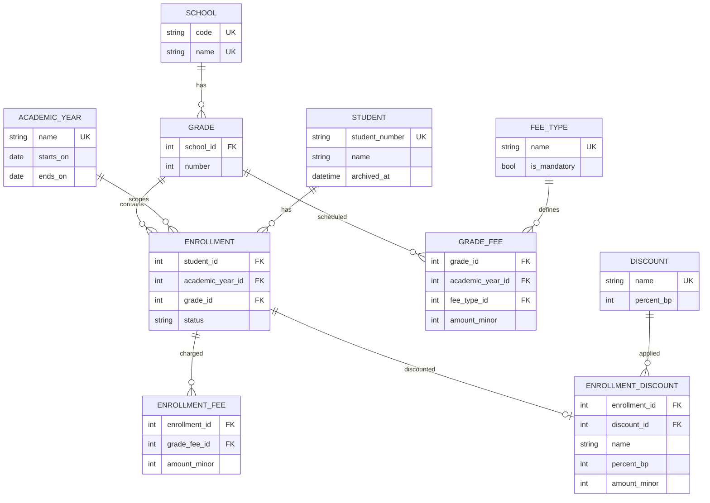

# School Management System

A modern, bilingual (English / Arabic) web application for running the administrative side of a school: academic structure, students and enrollment today, with fees, payments, reporting and more planned.

The system is being built as a complete product, delivered in well-defined phases. Each phase ships tested, documented and usable on its own. See the [Roadmap](#roadmap).

[](https://github.com/iam-omer-mahdi/school-management-system/actions/workflows/ci.yml)


<!--
Add screenshots here. Suggested set:
  docs/screenshots/login.png
  docs/screenshots/students-list.png
  docs/screenshots/students-list-dark.png
  docs/screenshots/students-list-ar-rtl.png
-->

## Table of contents

- [Features](#features)
- [Tech stack](#tech-stack)
- [Getting started](#getting-started)
- [Running the tests](#running-the-tests)
- [Architecture](#architecture)
- [Data model](#data-model)
- [Internationalization and RTL](#internationalization-and-rtl)
- [Security](#security)
- [Offline deployment](#offline-deployment)
- [Roadmap](#roadmap)
- [Contributing](#contributing)
- [License](#license)

## Features

Available now (Phase 1: Foundation):

**Academic structure**
- Schools, each with its own set of grades
- Academic years with an auto-generated name (for example `2026/2027`), one per start year, create-only, protected from deletion once enrollments exist

**Students and enrollment**
- Student records with auto-generated student numbers
- Contact, guardian and personal details
- Enroll a student into a grade for an academic year (one enrollment per student per year)
- Status lives on the enrollment: active, suspended, transferred, expelled, left, with notes and change timestamps
- Students can be archived (shown as inactive): hidden from the default list, blocked from new enrollments, fully viewable with history
- Search by name, student number or phone, Active/Inactive/All filter and pagination
- Enrollments section: gated list (school, grade and year, then apply) with live search, status and sorting, per-status counts and paginated totals
- Enrollment page: status changes, charges with per-fee paid/refunded/remaining, tuition discounts, payments with receipts, refunds of paid fees on ended enrollments, and void history

**Fees and discounts**
- Fee types (mandatory or optional) with a shared name normalizer; tuition is built in and protected
- Fee schedule per grade and academic year with an applied/skipped summary
- Fees are charged per enrollment: only active and suspended enrollments receive new mandatory fees
- Named discount catalog with percentage-based tuition discounts, snapshotted at apply time

**Accounts and security**
- Email and password sign-in
- Password recovery by emailed one-time code, or by security questions
- Self-service settings: change email (verified with a code sent to the new address), change password, update security questions

**Experience**
- Full English and Arabic interface with a proper right-to-left layout
- Light and dark themes
- Responsive layout with a mobile drawer and SPA-style navigation
- A reusable Blade UI component library (`x-ui`)

## Tech stack

| Layer | Choice |
| --- | --- |
| Language | PHP 8.5 |
| Framework | Laravel 13 |
| UI | Livewire 4 (single-file page components) |
| Styling | Tailwind CSS v4, Flowbite |
| Database | MySQL 8.4 |
| Tests | PHPUnit 12 |
| Code style | Laravel Pint |

## Getting started

### Requirements

- PHP 8.5 with the extensions Laravel requires
- Composer
- Node.js and bun

### Installation

```bash
git clone https://github.com/iam-omer-mahdi/school-management-system.git
cd school-management-system

composer install
bun install

cp .env.example .env
php artisan key:generate

php artisan migrate --seed

bun run build
```

### Run the app

```bash
composer run dev
```

Then open the URL printed in the terminal.

### Database

MySQL 8.4 is required for local development, tests and production. Create both databases before migrating:

```sql
CREATE DATABASE school_management CHARACTER SET utf8mb4 COLLATE utf8mb4_unicode_ci;
CREATE DATABASE school_management_testing CHARACTER SET utf8mb4 COLLATE utf8mb4_unicode_ci;
```

Connection settings live in `.env` (`DB_CONNECTION`, `DB_HOST`, `DB_PORT`, `DB_DATABASE`, `DB_USERNAME`, `DB_PASSWORD`); the test suite always uses `school_management_testing` and refuses to run against any other database.

Migrations may be edited until the first production deployment; after that, add new migrations only.

Back up production on a schedule (for example a nightly `mysqldump`) and test the restore regularly. Never run the test suite against the development or production database.

### Demo account

`php artisan migrate --seed` creates an initial administrator account (see `database/seeders/UserSeeder.php`). It exists for local development only. **Change the password immediately** and never run the seeder against a production database.

### Email in development

The default `.env.example` uses the `log` mailer, so password-reset and email-change codes are written to `storage/logs/laravel.log` instead of being sent. Configure a real SMTP provider in `.env` for production.

## Running the tests

```bash
php artisan test
```

Code style:

```bash
./vendor/bin/pint --test   # check
./vendor/bin/pint          # fix
```

The suite runs against a dedicated MySQL testing database (`school_management_testing`, recreated for every run) and covers authentication, the app shell, localization, school structure, academic years, student enrollment, password reset, email change and translated validation messages.

## Architecture

```text
app/
  Actions/        Single-purpose domain operations (CreateStudent, EnrollStudent, ...)
  Enums/          DisplayLocale, EnrollmentStatus
  Livewire/Forms/ Form objects (AcademicYearForm, StudentForm)
  Mail/           Mailables (reset codes)
  Models/         Eloquent models
  Services/       Cross-cutting services (PasswordResetService)
resources/
  views/pages/    Livewire single-file page components, routed with Route::livewire
  views/components/ui/   Reusable UI components
lang/             en and ar translation files
tests/Feature/    Feature tests
```

Conventions:

- Business rules live in **Actions** and **Services**, not in components.
- Validation and authorization happen inside the action that performs the change.
- Strict types, explicit return types and constructor property promotion throughout.
- Formatting is enforced with Pint.

## Data model

Phase 1 domain:



Key constraints: a grade number is unique per school, and a student has at most one enrollment per academic year. Foreign keys use `restrict` so history cannot be orphaned.

## Internationalization and RTL

- English and Arabic, switchable at any time. The choice is stored in the session and on the user profile.
- The layout flips to right-to-left for Arabic using logical CSS properties.
- Numbers are displayed with Western digits in both languages.
- Validation messages and attribute names are translated. A test fails if Arabic validation messages are missing.
- The Cairo font is bundled locally, so no external font requests are made.

## Security

- Passwords are hashed. Password-reset and email-change codes are stored hashed, expire in 10 minutes and are invalidated after 5 failed attempts.
- Sending codes and verifying them is rate limited.
- Password reset uses single-use, server-issued tokens that expire in 15 minutes. Completing a reset rotates the remember-me token.
- Security-question answers are normalized and stored hashed. The questions are the same for every email address, so the recovery flow does not reveal whether an account exists.
- Changing the email address requires proving access to the new address. Changing the password requires the current password.
- Administrators can reset any account with `php artisan user:reset-password {email}` (run on the server; the password is prompted for, never passed as an argument).

To report a vulnerability, please open a private security advisory on GitHub rather than a public issue.

## Offline deployment

The app itself works without internet access. Two things to know when deploying somewhere offline:

- The email-code features (forgot-password code, change-email code) need a configured mail server and will not function offline.
- Security questions are the offline recovery path. Answers may be invented, as long as they are memorable — treat them like passwords.
- `php artisan user:reset-password {email}` is the administrator fallback. Run it on the server when a user cannot recover access any other way.

## Roadmap

The product is delivered phase by phase. Scope for later phases is a plan, not a commitment, and will be refined as the earlier phases land.

| Phase | Focus | Status |
| --- | --- | --- |
| 1. Foundation | Authentication and account security, schools and grades, academic years, students, enrollment, English/Arabic with RTL, light/dark themes, UI component library | Done |
| 2. Fees and discounts | Fee structures per school, grade and academic year; installment plans; discount types and rules (sibling, scholarship, staff); per-student fee assignment | In progress |
| 3. Payments | Recording payments, receipts, per-fee and enrollment balances, refunds of paid fees for ended enrollments, voids | In progress |
| 4. Reports | Collection, outstanding balances and enrollment reports; filters by school, grade and year; export to PDF and Excel. Reports show all enrollments by default, with an active-only toggle and a breakdown by status, including balances owed by students who left | Planned |
| 5. Wider school management | Additional modules such as attendance, staff and academic records, to be defined once the finance core is complete | To be scoped |

Ideas for later (not committed): roles and auditing, activity log, backups.

## Contributing

Contributions and suggestions are welcome.

1. Fork the repository and create a branch from `main`.
2. Make your change with tests.
3. Run `php artisan test` and `./vendor/bin/pint`.
4. Open a pull request describing the change and why.

Commit messages follow [Conventional Commits](https://www.conventionalcommits.org/) (for example `feat(students): add status filter`).

## License

Released under the [MIT License](LICENSE).
